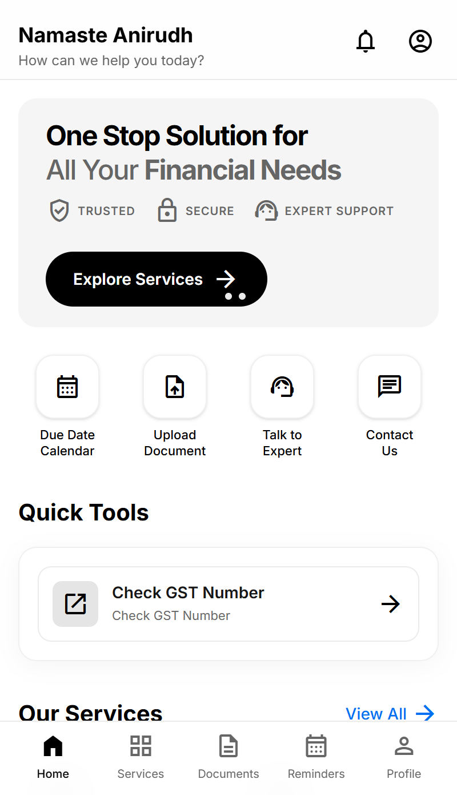
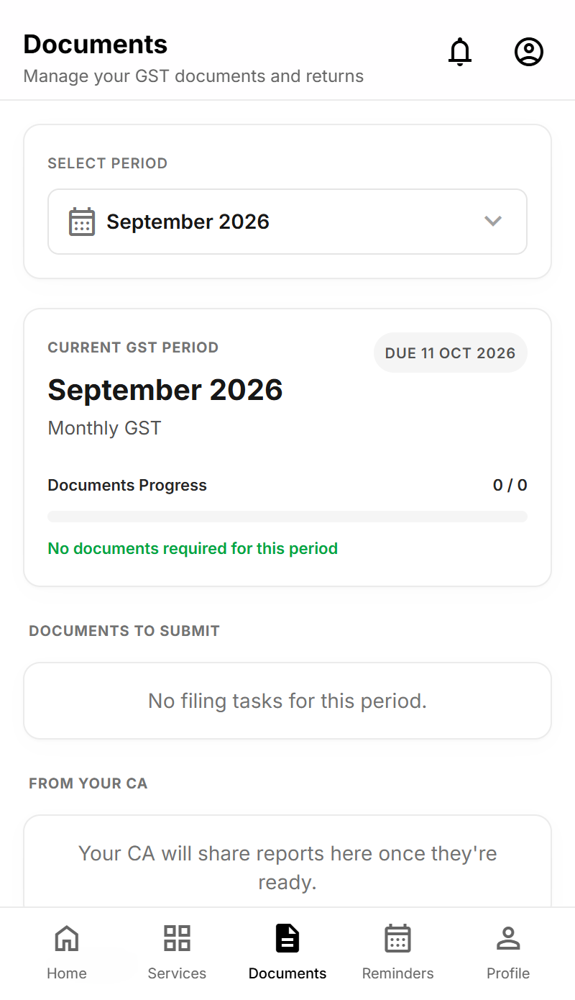
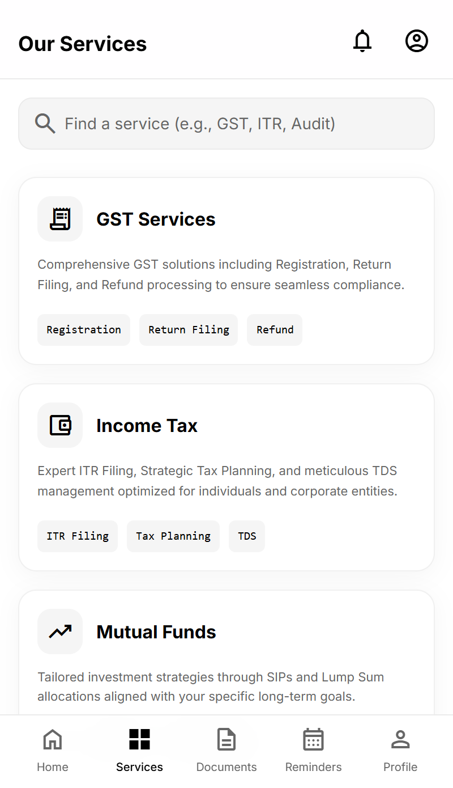
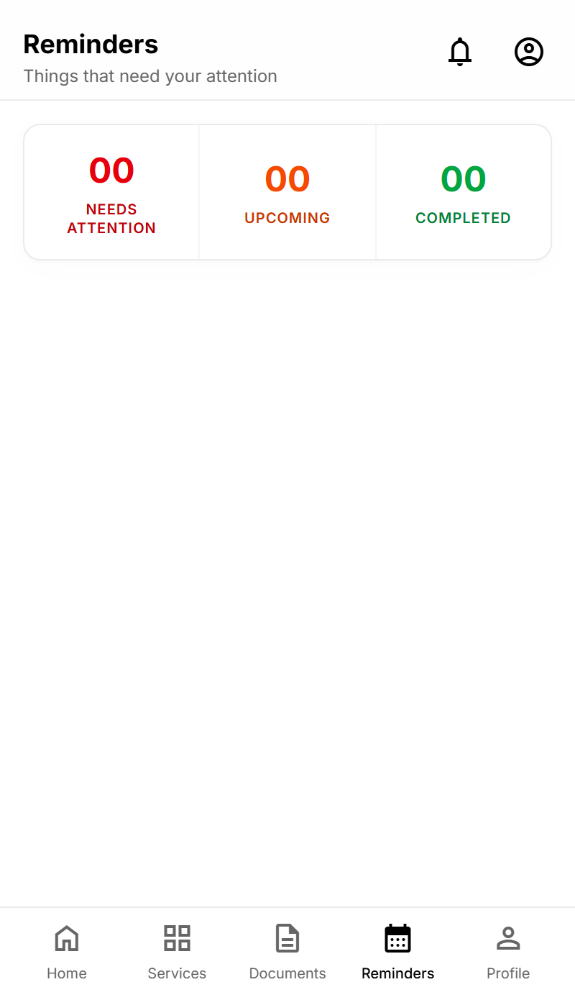
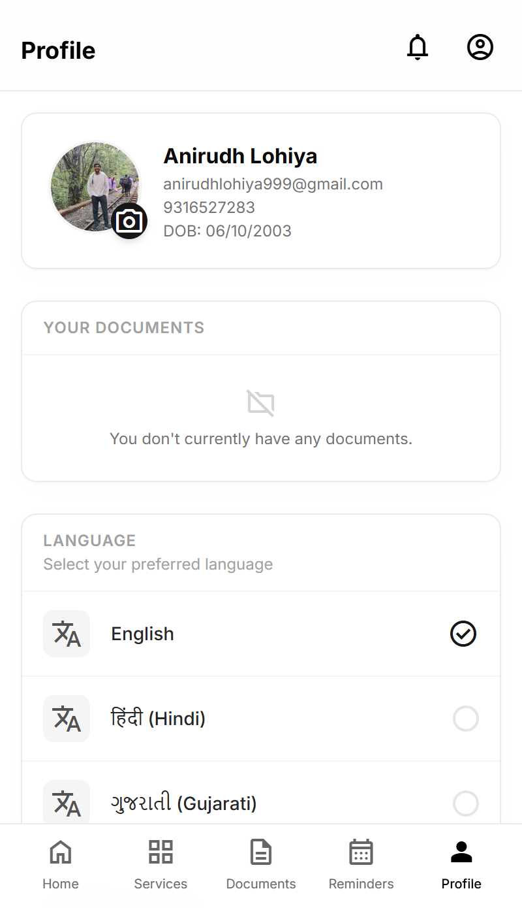
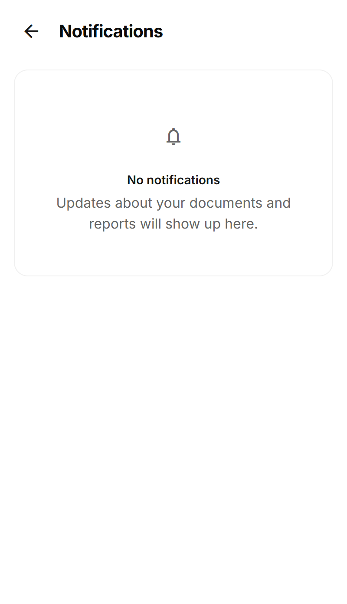
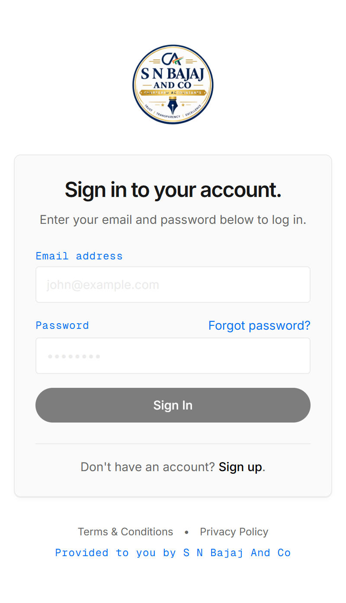
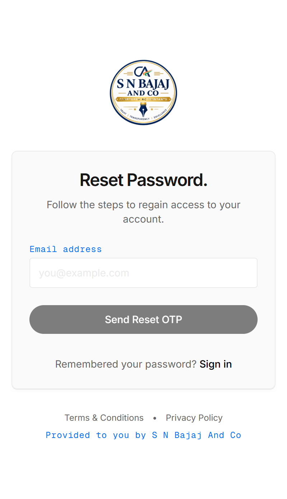
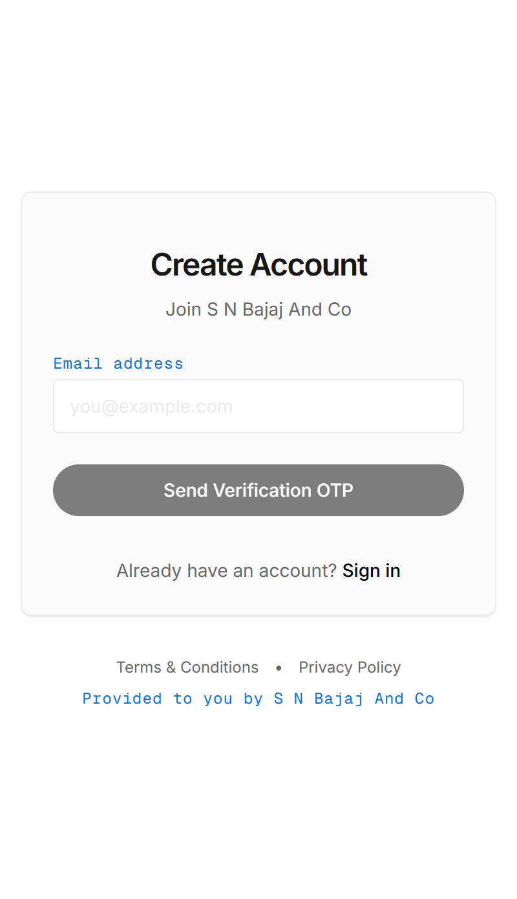
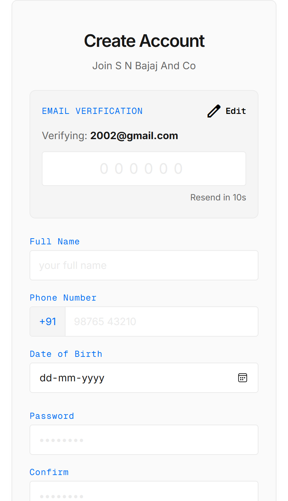

# SN Bajaj And Co — CA Practice Management & Client Portal Platform

[](https://app.snbajaj.com)
[](backend/)
[](admin/)
[](client/)
[](backend/)
[](deploy/)

A modern, full-stack practice management and client communication platform built for **SN Bajaj And Co** (Chartered Accountants). The platform replaces legacy manual email and WhatsApp interactions with a unified, automated ecosystem managing document collection, GST compliance tracking, ITR workflows, report delivery, support tickets, rent agreement generation, and AI-powered client support.

---

## 🌐 Live Production Deployments

| Component | URL | Description |
|---|---|---|
| **Client Portal (PWA)** | [app.snbajaj.com](https://app.snbajaj.com) | Mobile-first self-service portal for GST & ITR clients |
| **Admin Panel** | [admin.snbajaj.com](https://admin.snbajaj.com) | Management dashboard for CA and staff |
| **Backend API** | `api.snbajaj.com/api/v1` | Secure NestJS REST API with TypeORM & PostgreSQL |
| **Marketing Website** | [snbajaj.com](https://snbajaj.com) | Official firm showcase website hosted on Cloudflare Pages |

---

## 📱 Application Screenshots

### Client Portal Experience

| Dashboard | Document Management |
|:---:|:---:|
|  |  |
| *Home feed with service shortcuts, GST tools & quick actions* | *Period-based filing tracker, status & CA report access* |

| Services Catalog | Reminders & Deadlines |
|:---:|:---:|
|  |  |
| *Comprehensive CA catalog (GST, ITR, Mutual Funds)* | *Action tracker for urgent, upcoming & completed filings* |

| Profile & Language Preferences | Notification Center |
|:---:|:---:|
|  |  |
| *Client profile details & multilingual options (EN, HI, GU)* | *Centralized in-app updates for documents & filings* |

### Onboarding & Security

| Authentication & Sign-In | Password Reset Flow |
|:---:|:---:|
|  |  |
| *Secure credential sign-in for registered clients* | *Email OTP verification for seamless password recovery* |

| Registration (Step 1: Email) | Registration (Step 2: Profile & OTP) |
|:---:|:---:|
|  |  |
| *Initial signup with email OTP verification dispatch* | *OTP validation, personal details, and account setup* |

---

## 🚀 Key Features

### 1. Client Web Portal & PWA
- **Dual User Profiles**: Streamlined onboarding supporting both **GST Users** (with GSTIN validation and monthly/quarterly filing workflows) and **ITR Users** (annual tax return filings).
- **Direct-to-S3 Document Uploads**: High-speed, secure uploads via time-limited pre-signed URLs — client files bypass the backend application server entirely.
- **Filing Periods & Nil Declarations**: Real-time progress monitoring per period, one-tap Nil return declarations, and direct report downloads.
- **Support Tickets**: Integrated client ticketing system with threaded messaging and document attachments.
- **Progressive Web App**: Installable to iOS/Android home screens with native-like mobile responsiveness and offline resilience.
- **Multilingual Support**: Built-in language switching (English, Hindi, Gujarati) for seamless regional accessibility.
- **Self-Service Onboarding**: Streamlined 2-step OTP registration and automated password recovery flows.
- **Notification Hub**: Real-time alerts and status updates on submitted documents and published CA reports.

### 2. Admin Management Panel
- **Client & Staff Oversight**: Full client directory with bulk Excel import (`import-clients.ts`), pre-registration auto-linking, and granular role-based permissions (`view_clients`, `upload_reports`, `send_reminders`, `manage_services`, `manage_tickets`, etc.).
- **Compliance Task Checklist**: Automated monthly & quarterly task generation for GSTR-1, GSTR-3B, IFF, Sales/Purchase bills, and GST payment tracking.
- **Visual Filing Schedule Editor**: Intuitive calendar and deadline configuration without editing raw JSON schedules.
- **Automated Rent Agreements**: Dynamic DOCX generation engine using `docxtemplater` & `pizzip`, WYSIWYG preview, and optional OnlyOffice integration.
- **Audit Logs**: Immutable logging of administrative actions, data edits, and reminder dispatches.

### 3. WhatsApp AI Support Desk
- **Zero-Cost Architecture**: Operates within Meta Cloud API's 1,000 free monthly service conversations and Groq's high-speed free tier (`openai/gpt-oss-120b` with multi-model fallback).
- **Client Auto-Linking**: Automatically links incoming WhatsApp messages to registered portal clients via phone number lookup.
- **Real-Time Staff Takeover**: Server-Sent Events (SSE) live chat desk with 24-hour service window tracking and manual agent takeover.

### 4. Multi-Channel Notifications & Automation
- **Filing Reminders**: Automated daily cron at 08:00 server time targeting clients with pending filings near statutory due dates.
- **Birthday Greetings**: Automated dual-pass cron (00:01 & 23:59 IST) sending personalized wishes via AWS SES email and Web Push notifications.
- **Push & Email Delivery**: Amazon SES email delivery with bounce/complaint suppression handling and VAPID-based browser Web Push.

### 5. Android Wrapper App
- **Native Shell (`android-wrapper/`)**: Lightweight Kotlin WebView wrapper (`com.snbajaj.portal`) with customized launcher assets.
- **Server-Driven Forced-Update Gate**: Dynamically queries `GET /api/v1/app/version` to enforce minimum app versions for secure document transfers.

---

## 🛠️ Technology Stack

| Layer | Technologies |
|---|---|
| **Backend API** | Node.js 22, NestJS 11, TypeScript, TypeORM, class-validator, Argon2, `@nestjs/schedule` |
| **Database** | PostgreSQL 16 (Strict migrations with `synchronize: false`) |
| **Frontends** | Angular 20 (Standalone components), Tailwind CSS v4, `@angular/service-worker` |
| **Cloud Infrastructure** | AWS Lightsail (Ubuntu), Amazon S3 (Private buckets), Amazon SES (Email), VAPID Web Push |
| **Mobile & Web Shell** | Android Studio / Kotlin (WebView wrapper), Astro (Marketing website) |
| **Reverse Proxy & Process** | Nginx, PM2, Certbot (Let's Encrypt SSL/TLS) |

---

## 📁 Repository Structure

```
├── admin/               # Angular 20 Admin Panel (served at /admin/)
├── client/              # Angular 20 Client PWA (mobile-first portal)
├── backend/             # NestJS 11 TypeScript REST API (/api/v1/)
├── website/             # Astro marketing website for snbajaj.com
├── android-wrapper/     # Kotlin Android WebView wrapper application
├── screenshots/         # Production UI screenshots and previews
├── deploy/              # Production deployment scripts, Nginx configs, PM2 ecosystem
├── docs/                # Comprehensive project documentation
│   ├── 01-prd.md        # Product Requirements Document
│   ├── 02-trd.md        # Technical Requirements Document
│   ├── 03-app-flow.md   # Application flow & user journeys
│   ├── 05-backend-schema.md # Database schema & relationships
│   ├── 08-project-handbook.md # Architecture handbook & gotchas
│   ├── 09-run-and-test-guide.md # Local setup & testing guide
│   ├── 10-phase5-deploy-runbook.md # AWS deployment runbook
│   └── 14-whatsapp-local-testing-guide.md # WhatsApp testing & webhooks
└── PROJECT_CONTEXT.md   # Single source of truth for architecture and phases
```

---

## ⚡ Quick Start (Local Development)

### Prerequisites
- Node.js 22+ & npm
- PostgreSQL 16 (running locally or via Docker `ca-pg`)
- Angular CLI 20 (`npm install -g @angular/cli`)

### 1. Backend Setup
```bash
cd backend
cp .env.example .env
npm install

# Run database migrations
npm run migration:run

# Seed initial superadmin & test client data
npm run seed

# Start API in development mode (http://localhost:3000/api/v1)
npm run start:dev
```

### 2. Admin Panel Setup
```bash
cd admin
npm install

# Start Admin web app (http://localhost:4201)
npm start
```

### 3. Client Portal Setup
```bash
cd client
npm install

# Start Client PWA (http://localhost:4200)
npm start
```

> 💡 For comprehensive end-to-end testing instructions and environment variables configuration, refer to [`docs/09-run-and-test-guide.md`](docs/09-run-and-test-guide.md).

---

## 🔒 Security & Best Practices

- **Zero-Storage Direct S3 Uploads**: User documents never pass directly through the API server memory or local disk; files transfer directly to Amazon S3 via cryptographically signed PUT URLs.
- **Rate Limiting & Protection**: Global IP rate limiting via `@nestjs/throttler`, strict helmet HTTP headers, and CORS origin allowlists.
- **Fail-Fast Boot Checks**: Production backend enforces minimum 32-character JWT secrets, valid database passwords, and disables Swagger documentation automatically.
- **Audit Trails**: Full database logging of sensitive operations including client data modifications, manual reminder dispatches, and role grants.

---

## 📄 License & Maintainer

Maintained for **SN Bajaj And Co**. All rights reserved.